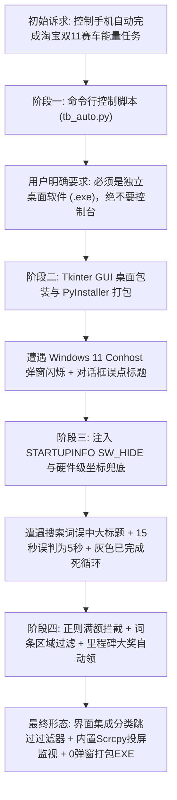

# 淘宝双11「淘金币组队赛车」自动化助手产品与架构技术规范 (SPEC)

> **Document ID:** SPEC-TB11-AUTO-202610  
> **Product Type:** Windows 桌面自动化辅助软件 (GUI + CLI)  
> **Target Release:** v1.2 (Production Stable)  
> **Date:** 2026-10-29  
> **Author:** Antigravity Engineering & QA Team  

---

## 1. 需求访谈与架构决策链 (Decision Chain)

本项目经历多轮高强度工程对齐与实战真机检验，以下为从初始模糊脚本演进为工程级桌面独立软件的关键决策链：



### 核心决策卡片 (Decision Highlights)

* 🎯 **产品定位 (Product Positioning)**：  
  面向 Windows 用户的**免安装、双击即用、零弹窗干扰**的 Android 大促自动化辅助软件。全本地离线运行，免 Root，不抢占鼠标，通过无线 ADB 与 RapidOCR 实现端侧物理级拟人操作。
* 🔥 **四大核心技术原则 (Core Principles)**：
  1. **零控制台干扰 (No-Console Enforcement)**：所有底层 ADB 子进程全面注入 `STARTF_USESHOWWINDOW`、`SW_HIDE` 与 `CREATE_NO_WINDOW`，彻底阻断 Windows 11 终端窗口跳动与任务栏闪烁。
  2. **AI 视觉驱动而非死磕页面元素 (OCR-Driven State Machine)**：基于离线 ONNX 视觉模型（RapidOCR）识别手机屏幕文字与按钮位置，具备抗 UI 变动与动态排版自适应能力。
  3. **状态机与严格过滤 (Strict Guardrails)**：通过正则识别 `(10/10)` 满额状态、坚决剔除带“已”字的灰色按钮，彻底杜绝已完成任务的连击死循环。
  4. **软硬结合的投屏与监视体验 (Embedded Observability)**：内置打包 `scrcpy` 投屏组件，无需用户额外配置环境变量或外部工具链，一键唤起真机低延迟画面。
* 👥 **目标用户 (Target Users)**：  
  参加淘宝双11「狂享20亿」淘金币组队赛车的普通手机用户与多开工程师，需在不占用电脑正常工作/娱乐的前提下，全自动打满每日 30~50 个繁琐大促任务与里程碑奖励。

---

## 2. 问题定义 (Problem Statement)

每年双11期间，淘宝推出大规模互动玩法（如淘金币组队赛车赢现金红包）。用户需要升级赛车必须完成大量每日能量任务（高达 50 次/天）：
1. **任务繁杂枯燥**：包含商品 15 秒浏览、搜索商品浏览、小程序跨端访问等，单人手工操作耗时高达 40~60 分钟。
2. **防沉迷与滑动检测严格**：页面必须保持活跃上下滑动，否则倒计时悬浮窗立即暂停。
3. **传统无障碍/Root 工具风险高**：市面上脚本大多需要 Root 权限、安装可疑 APK 或抢占电脑鼠标光标，且极易被平台风控检测。
4. **命令行脚本上手门槛高**：普通用户面对 Python 环境、ADB 端口、CMD 窗口与报错缺乏排查能力，亟需开箱即用的图形化独立客户端。

---

## 3. 整体解决方案 (Solution Architecture)

系统由**四大核心引擎模块**构成：

```
┌────────────────────────────────────────────────────────┐
│               TaobaoAutoHelper 桌面 GUI (Tkinter)       │
│  [设备状态监视] [无线ADB连接] [📱投屏监视] [任务过滤设置] │
└──────────────────────────┬─────────────────────────────┘
                           │ 调度与事件流
┌──────────────────────────▼─────────────────────────────┐
│               自动化控制引擎 (AutoTaskEngine)           │
│  - 状态识别状态机          - 动态黑名单过滤器            │
│  - 往复模拟滑动调度器      - 里程碑大奖自动认领器        │
└────────────┬─────────────────────────────┬─────────────┘
             │ 屏幕图像流                  │ 静默内核控制流
┌────────────▼──────────────┐ ┌────────────▼─────────────┐
│  AI 视觉引擎 (RapidOCR)   │ │  静默 ADB 驱动 (SW_HIDE)  │
│  - 离线 ONNX 字符与框体识别│ │  - 熄屏自动点亮与唤醒     │
│  - 过滤静态标题/拾取商品词│ │  - 内核 tap / swipe 注入 │
│  - 正则分子分母满额校验    │ │  - 无窗创建 (CREATE_NO_WIN)│
└───────────────────────────┘ └──────────────────────────┘
```

---

## 4. 用户故事 (User Stories)

* **US-01 [开箱即用]**：作为一个普通电脑用户，我希望直接双击桌面上的软件图标就能启动程序，不需要自己安装 Python、配置环境变量或敲命令行。
* **US-02 [无线连接]**：作为一个无线操作用户，我希望在手机开启无线调试后，只需在软件输入一次 `IP:端口` 点击连接，即可与手机建立稳定通信。
* **US-03 [后台静默]**：作为一个办公/游戏用户，我希望软件在自动跑任务时完全不弹任何黑色的 CMD 窗口，也不抢夺我的鼠标光标。
* **US-04 [实时视窗]**：作为一个希望了解执行进度的用户，我希望点击【📱 打开投屏监视】按钮就能在电脑上实时看到手机投屏，方便观察。
* **US-05 [任务自由过滤]**：作为一个有特定偏好的用户，我希望能自由勾选跳过考试答题、邀请好友或小程序跳转任务，并支持输入自定义跳过词。
* **US-06 [杜绝死循环]**：作为一个放飞自动化的用户，我希望程序在任务显示 `已完成` 或 `(10/10)` 时能自动跳过，绝不重复无效点击。
* **US-07 [大奖自动领]**：作为一个希望拿满收益的用户，我希望程序在每次回到主面板时，自动识别并点击上方的 `+1000`、`+2000` 里程碑大奖。

---

## 5. 核心技术实现与工程决策 (Implementation Decisions)

### 5.1 零控制台弹窗与无感执行 (Anti-Popup Engine)
在 Windows 环境下，任何 `subprocess.run` 或 `Popen` 唤起外部控制台程序（如 `adb.exe`）时，Windows Terminal 或 Conhost 默认都会创建可见窗口闪烁。
本系统全局固化 Windows 底层系统启动参数：
```python
STARTUP_INFO = subprocess.STARTUPINFO()
STARTUP_INFO.dwFlags |= subprocess.STARTF_USESHOWWINDOW
STARTUP_INFO.wShowWindow = 0  # SW_HIDE
NO_WINDOW_FLAGS = 0x08000000  # CREATE_NO_WINDOW
```
所有 ADB 通信均显式注入此参数，彻底实现进程级静默。

### 5.2 视觉引导与多重状态校验 (Visual Guardrails)
1. **已结任务彻底熔断**：
   * 收集右侧按钮时强制增加 `"\u5df2" not in text` 校验，坚决剔除包含“已”字（如 `已完成`、`已领取`）的灰色禁用按钮。
   * 正则匹配任务行文本 `r'\((\d+)/(\d+)\)'`，当分子等于分母时标记为 `is_finished=True` 并跳过。
2. **搜索落地页智能拾取**：
   * 严禁将包含“发现”等字眼作为关键词匹配，彻底避开“搜索发现”、“历史搜索”等静态区域大标题。
   * 仅在 $1000 < Y < 2300$ 区域内提取有效商品标签（如 `hbn`、`显卡`、`模型` 等），兜底点击右上角 $(970, 180)$ 真实搜索按钮进入列表页。
3. **计时严格隔离**：
   * 严禁使用 `"5秒" in text` 进行子串匹配，优先判定 `"15秒"` 赋予 18 秒活跃往复滑动，确保打满悬浮能量进度条。
4. **跨应用授权弹窗智能点击**：
   * 精确判定底部操作按钮（$Y > 2000$ 且 $X > 600$ 且文字为“打开/允许”），并设置硬件级坐标 $(870, 2350)$ 兜底，绝不误触居中的弹窗标题。

### 5.3 投屏组件无缝内嵌
将 `scrcpy 5.0.1` 核心组件（`scrcpy.exe`、`scrcpy-server`、`SDL3.dll`、`avcodec` 等全套多媒体解码库）直接集成于软件根目录。通过 `sys.executable` 动态基准路径自动解析，实现零外部依赖的一体化投屏。

---

## 6. 测试接缝与真机集成验证 (Testing Seams & Verification)

| 验证项 (Verification Seam) | 检验方式 (Observation Method) | 判定标准 (Pass Criteria) | 状态 |
| :--- | :--- | :--- | :--- |
| **SEAM-01: 静默通信** | 启动任务连续执行 50 步 | 屏幕与任务栏无任何 CMD / conhost 窗口闪烁跳动 | ✅ PASS |
| **SEAM-02: 搜索任务流** | 命中“搜一搜宝贝”任务 | 准确点击商品标签进入列表，顶部出现 15 秒悬浮条 | ✅ PASS |
| **SEAM-03: 15秒时长** | 监控 15 秒任务滑动用时 | 连续滑动 18 秒，进度条 100% 达成后退回主面板 | ✅ PASS |
| **SEAM-04: 满额任务跳过** | 遇到 `好物随心逛 (10/10) [已完成]` | 日志输出跳过提示，自动下翻寻找新任务，绝不进入 | ✅ PASS |
| **SEAM-05: 弹窗授权** | 唤起“想要打开支付宝小程序” | 自动点击底部【打开】按钮并顺利进入并返回 | ✅ PASS |
| **SEAM-06: 投屏监视** | 点击【📱 打开投屏监视】 | 1 秒内无缝唤起 PKT110 手机实时投屏画面 | ✅ PASS |
| **SEAM-07: 里程碑领奖** | 界面进度达到 33/50 | 自动点击上方 `+1000` / `+2000` 立即领取落袋 | ✅ PASS |

---

## 7. 明确不做与非本次范围 (Out of Scope)

1. **AI 题库答题 (Quiz Solver)**：目前省钱等级考试题目随机且变动快，不做题库爬取与答案计算，统一采用规则跳过。
2. **好友拼团助力 (Team Invite Helper)**：不包含自动化群发微信/QQ 分享链接或拉真实用户的功能。
3. **代付下单与真金白银消费 (Payment/Ordering)**：坚决不做任何涉及支付密码、下单结算的自动化逻辑。
4. **iOS 越狱与苹果端自动化**：本产品专注服务 Android 11~15 (ColorOS / MIUI / HarmonyOS / OriginOS) 架构。

---

## 8. 版本发布记录与里程碑

* **v1.0 (2026-10-28)**：实现基础 ADB 控制与 RapidOCR 文本识别，打通 15s/5s 纯浏览任务。
* **v1.1 (2026-10-28)**：全面封装 Tkinter 桌面版 EXE，彻底修复 Windows 11 CMD 弹窗问题与搜索落地页误点静态标题问题。
* **v1.2 (2026-10-29)**：
  - 新增已完成任务 `(10/10)` 与灰色 `已完成` 按钮的严格状态熔断。
  - 新增上方里程碑 `+1000` / `+2000` 大奖开局自动领取。
  - 软件根目录直接内置打包 `scrcpy 5.0.1` 极速高清投屏。
  - 界面新增【任务跳过与过滤设置】分类勾选面板与自定义跳过词栏。
